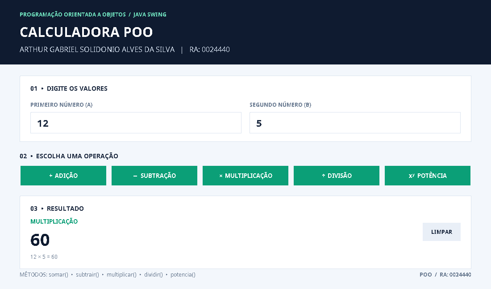

# Calculadora em Java — POO

**Aluno:** Arthur Gabriel Solidonio Alves Da Silva  
**RA:** 0024440  
**Disciplina:** Programação Orientada a Objetos (POO)

## Sobre o trabalho

Neste trabalho, desenvolvi uma calculadora em Java utilizando os conceitos de Programação Orientada a Objetos (POO). O programa realiza cinco operações matemáticas: adição, subtração, multiplicação, divisão e potência. Também organizei o código e criei uma interface gráfica para facilitar o uso da calculadora, permitindo realizar os cálculos de forma simples e prática.

## Operações da calculadora

- Adição — `somar()`
- Subtração — `subtrair()`
- Multiplicação — `multiplicar()`
- Divisão — `dividir()`
- Potência — `potencia()`

A calculadora permite digitar números, usar vírgula ou ponto decimal, limpar a tela e calcular pelo botão `=`. O resultado aparece junto com a conta completa. Por exemplo, em uma multiplicação de 12 por 5, a tela mostra **12 × 5 = 60**. Também tem uma verificação para não permitir divisão por zero.

## Print da tela



O título do formulário com meu nome e RA está definido no arquivo `Calc.java`.

## Como executar

É necessário ter o Java JDK instalado. No Windows, abra `executar.bat`.

Também é possível executar pelo terminal dentro desta pasta:

```bash
javac -encoding UTF-8 -d build src/calculadora/Calculadora.java src/calculadora/Calc.java src/calculadora/TesteCalculadora.java
java -cp build calculadora.Calc
```

Para testar as cinco operações:

```bash
java -cp build calculadora.TesteCalculadora
```

## Arquivos

- `src/calculadora/Calc.java` — tela e botões, continuando o código da aula.
- `src/calculadora/Calculadora.java` — métodos das cinco operações.
- `src/calculadora/TesteCalculadora.java` — testes dos cálculos.
- `prints/tela_calculadora.png` — print da calculadora funcionando.