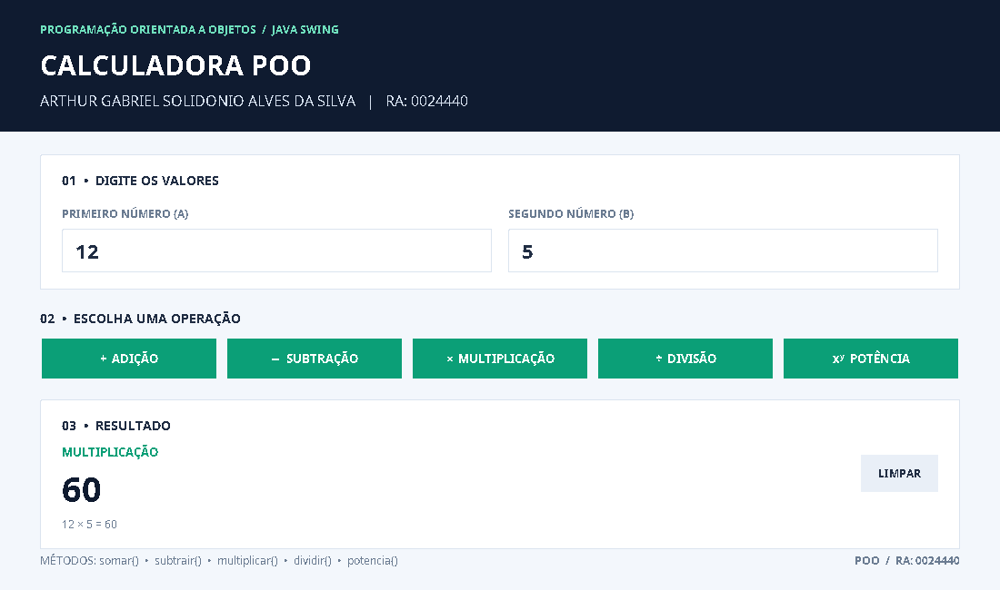

# Calculadora em Java — POO

**Aluno:** Arthur Gabriel Solidonio Alves Da Silva  
**RA:** 0024440  
**Disciplina:** Programação Orientada a Objetos (POO)

## Sobre o trabalho

Neste trabalho, fiz uma calculadora em Java para praticar os métodos e os conceitos de POO vistos em aula. Usei a classe `Calculadora` para organizar as operações e o Java Swing para criar uma tela em que é possível digitar dois números e escolher a conta.

Além das quatro operações básicas, também coloquei a potenciação. No título da janela aparecem meu nome completo e meu RA.
## Operações

- Adição — `somar()`
- Subtração — `subtrair()`
- Multiplicação — `multiplicar()`
- Divisão — `dividir()`
- Potência — `potencia()`

Também fiz uma verificação para não permitir divisão por zero.

## Print da calculadora



## Como executar

É necessário ter o Java JDK instalado. No Windows, basta abrir o arquivo `executar.bat`.

Também dá para executar pelo terminal, na pasta principal do projeto:

```bash
javac -encoding UTF-8 -d build src/Calculadora.java src/Main.java src/TesteCalculadora.java
java -cp build Main
```

Para testar os métodos, use:

```bash
java -cp build TesteCalculadora
```

## Arquivos do projeto

- `src/Calculadora.java` — contém os cinco métodos.
- `src/Main.java` — contém a tela da calculadora.
- `src/TesteCalculadora.java` — contém os testes das operações.
- `prints/tela_calculadora.png` — imagem da calculadora funcionando.
